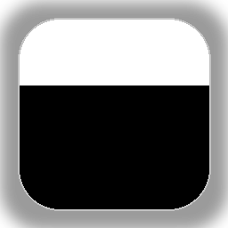
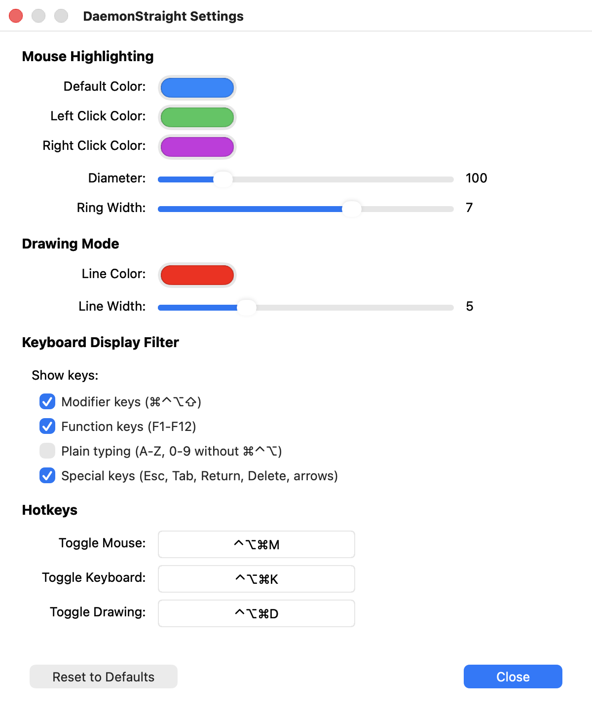

<p align="center">
  
</p>

<h1 align="center">DaemonStraight</h1>

<p align="center">
  A lightweight macOS menu bar app that makes live demos and screen sharing easier to follow:<br>
  it highlights the cursor, shows the shortcuts you press, and lets you draw on top of the screen.
</p>

<p align="center">
  
  
  
  <a href="https://github.com/shatalov-alex/DaemonStraight/releases/latest"></a>
  <a href="LICENSE"></a>
</p>

---

## Features

- **Cursor highlighting.** A soft, glowing double ring follows the pointer. Pressing a mouse button shrinks the ring
  and changes its color (separate colors for left and right clicks), so viewers can see every click.
- **Shortcut display.** Key combinations such as `⌘⇧4` or `⌃⌥→` appear as keycaps in a corner of the screen and fade
  out after a few seconds, as do clicks made with modifiers, such as `⌘ Click`. Keys are detected by physical position,
  so they are shown correctly with any keyboard layout.
- **Spotlight.** Dims the screen except a soft circle around the pointer, so the audience looks exactly where you point.
- **On-screen drawing.** Hold `⇧` and move the mouse to draw freehand, or hold `⌃⇧` for straight lines. Drawings fade
  out automatically shortly after you release the keys.
- **Click-through overlay.** The overlay never takes focus or intercepts clicks, so you keep working normally.
- **Multiple displays.** Works on every connected display, and adapts when displays are connected, disconnected
  or rearranged. Shortcuts are shown on all displays, so they're visible whichever screen you share.
- **Menu bar only.** No Dock icon and no windows in the way. Everything is controlled from the menu bar or with global hotkeys.
- **Updates in the app.** Check for new versions from the menu, or at every start if you allow it. An update found at
  start only changes the menu bar icon, so no window appears in the middle of a presentation.
- **Customizable.** Colors, sizes, which keys to display, where to show them, the toggle hotkeys and the features that turn
  on at launch can all be changed in Settings.

<p align="center">
  <picture>
    <source media="(prefers-color-scheme: dark)" srcset="docs/images/settings-dark.png">
    
  </picture>
</p>

## Requirements

- macOS 13.5 or later
- Accessibility permission (needed to observe global keyboard and mouse events; see [Privacy](#privacy))
- To build from source: Xcode 16 or later

## Installation

### Download

1. Download `DaemonStraight-<version>.dmg` from the [latest release](https://github.com/shatalov-alex/DaemonStraight/releases/latest).
2. Open it and drag **DaemonStraight** to **Applications**.
3. Open the app. It isn't notarized by Apple, so the first time macOS says it can't verify the developer.
   Close the message, then go to **System Settings → Privacy & Security**, scroll down and click **Open Anyway**.
4. Grant Accessibility access (see [below](#granting-accessibility-access)).

The app runs on both Apple silicon and Intel Macs. To update later, use **Check for Updates...** in the menu.

### Build from source

1. Clone the repository:
   ```bash
   git clone https://github.com/shatalov-alex/DaemonStraight.git
   cd DaemonStraight
   ```
2. Set your Apple Developer team for code signing by creating `Config/Local.xcconfig` (ignored by git):
   ```bash
   echo 'DEVELOPMENT_TEAM = YOUR_TEAM_ID' > Config/Local.xcconfig
   ```
   Your team ID is shown in Xcode under **Settings → Accounts**, or at
   [developer.apple.com/account](https://developer.apple.com/account).
3. Open `DaemonStraight.xcodeproj` in Xcode and press **⌘R** to build and run.

To produce a standalone universal release build in `build/Release/`, run:

```bash
./scripts/build_release.sh
```

### Granting Accessibility access

On first launch, macOS asks you to allow DaemonStraight to control your computer. Open
**System Settings → Privacy & Security → Accessibility** and enable **DaemonStraight**, then restart the app.

> [!NOTE]
> macOS ties this permission to the app's code signature. If you rebuild the app with a different (or ad-hoc)
> signature, remove the old entry from the list and grant access again. Releases after 1.1.0 share one
> certificate, so updating from one of them to a newer one keeps the permission.

## Usage

Toggle features from the menu bar icon or with the default hotkeys:

| Feature             | Hotkey  |
| ------------------- | ------- |
| Cursor highlighting | `⌃⌥⌘M`  |
| Shortcut display    | `⌃⌥⌘K`  |
| Drawing mode        | `⌃⌥⌘D`  |
| Spotlight           | `⌃⌥⌘S`  |
| All features on/off | `⌃⌥⌘A`  |

By default all features are off when the app starts. Choose the ones that turn on at launch in
**Settings → General → At Launch**.

### Tip: start and stop with your presentation

DaemonStraight is only needed while you present, so it works well with the **Shortcuts** app. Create one shortcut that
opens DaemonStraight (with the features you need turned on at launch), joins your next meeting and turns on a Focus mode,
and another one that quits DaemonStraight and turns the Focus mode off. Add both to the menu bar or the Dock, and the
whole setup is one click before and after the call.

### Drawing

While drawing mode is on:

| Action                     | How                                     |
| -------------------------- | --------------------------------------- |
| Freehand line              | Hold `⇧` and move the mouse             |
| Straight line              | Hold `⌃⇧` and move the mouse            |
| Switch line type mid-stroke | Press or release `⌃` while holding `⇧` |
| Keep drawings on screen    | Hold `⌘`, `⌥`, `⌃` or Caps Lock         |
| Clear immediately          | Menu bar → **Clear Drawing**            |

Drawings fade out three seconds after you release `⇧`.

### Settings

Open **Settings…** from the menu bar icon (or press `⌘,` while the menu is open) to change:

- **Mouse:** ring colors (idle, left click, right click), diameter and ring width; spotlight diameter and dimming
- **Keyboard:** which keys the shortcut display shows (modifiers, function keys, special keys, clicks with modifiers
  and, optionally, plain typing), the screen corner and the key size
- **Drawing:** line color and width
- **General:** the toggle hotkeys (each must include at least one of `⌃`, `⌥` or `⌘`), the features that turn on at launch
  and whether to check for updates when the app starts

Changes apply immediately and are saved automatically.

## Privacy

DaemonStraight observes keyboard and mouse events only to draw the overlay in real time.

- Pressed keys are **never written to logs or disk** and are kept in memory only while they are on screen.
- The app connects to the network **only to check for updates**, when you choose **Check for Updates...** or allow
  checks at start (it asks once, and you can change this in **Settings → General**). It then downloads a small file with
  the latest version number from this project's GitHub releases. No personal data or usage statistics are sent;
  as with any download, GitHub can see your IP address.
- Updates are installed only after you confirm them, and their signature is checked first. They are handled by a
  helper from the [Sparkle](https://sparkle-project.org) framework; the app itself has no network permission.
- Settings are stored locally in the app's preferences (`UserDefaults`).

### Verifying a download

Releases are signed with a self-signed certificate: [`Config/release-certificate.pem`](Config/release-certificate.pem).
It doesn't replace Apple's notarization, but you can check that an app comes from this project:

```bash
codesign -d -r- /Applications/DaemonStraight.app
```

The output must contain `f691fccd86582aa17b5ec5a6cf598b8a857e531e`, the certificate's SHA-1 fingerprint.

## Project structure

```
DaemonStraight/
├── main.swift                       App entry point (menu bar app, no Dock icon)
├── AppDelegate.swift                Status bar menu, global hotkeys, overlay window
├── ViewController.swift             Event monitoring, shortcut filtering, drawing control
├── TransparentOverlayWindow.swift   Full-screen, click-through overlay window (one per display)
├── CircleView.swift                 Cursor highlight rings and click animation
├── SpotlightView.swift              Dimmed screen with a circle around the cursor
├── DrawView.swift                   Drawing canvas with fade-out
├── ShortcutPressedViewContainer.swift, ShortcutPressedView.swift,
│   ButtonView.swift, BlurredView.swift, KeyShape.swift, KeyMapping.swift
│                                    Keycap rendering for the shortcut display
├── UpdateManager.swift              Update checks (Sparkle)
├── SettingsManager.swift            Persistent settings
└── SettingsWindowController.swift   Settings window and hotkey recorder
scripts/
├── build_release.sh                 Universal (Apple silicon + Intel) release build
├── release.sh                       Versions, tags, packages and publishes a release
├── create_signing_certificate.sh    Creates the release certificate (run once)
└── generate_icons.py                Generates the app and menu bar icons (requires Pillow)
```

## Versioning

DaemonStraight follows [Semantic Versioning](https://semver.org): releases are tagged `vMAJOR.MINOR.PATCH`, and every
change is listed in the [changelog](CHANGELOG.md). Maintainers publish a release with `./scripts/release.sh X.Y.Z`.

## Contributing

Bug reports and pull requests are welcome. For larger changes, please open an issue first to discuss what you would
like to change.

## License

DaemonStraight is released under the [MIT License](LICENSE).
